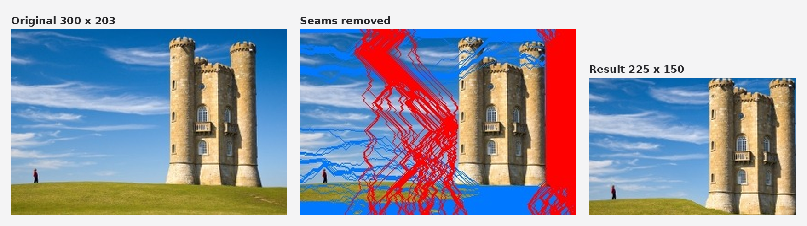

# Seam Carving

A Python program that shrinks an image to a smaller width and height by removing the least noticeable lines of pixels, so the main subject keeps its shape instead of being squashed or cropped.



## What it does

- Resizes any PNG or JPG to a smaller size, from a browser app or the command line.
- Lets you choose how the lines of pixels (seams) are picked: dynamic programming, a greedy method, or graph cut.
- Draws every removed seam on the original picture, so you can see what was taken out.
- Steps through the resize one seam at a time, and exports it as an animated GIF.
- Compares the methods side by side on the same image, with the time each took.

## My part

Team of six. I built the core pipeline that all three methods plug into: the energy map, seam removal, and the resize loop, including shrinking the height. I also set up the shared interface every method follows, the command-line tool, and the CI on GitHub Actions, which runs the test suite on every pull request and blocks merging into `main` until it passes.

Teammates built the dynamic programming, greedy and graph cut methods, the benchmarks, and the visualisation and browser app. See [docs/DEVELOPMENT.md](docs/DEVELOPMENT.md) for who built what.

## Built with

Python 3.11, NumPy, OpenCV, Streamlit, Pillow, Matplotlib, pytest, GitHub Actions.

## How to run

```bash
git clone https://github.com/wjlim-dev/csd3131_Seam_Carving.git
cd csd3131_Seam_Carving
pip install -r requirements.txt
streamlit run app.py
```

Or from the command line:

```bash
python cli.py images/sample.png --width 180 --height 130 --algo dp --output out/dp.png
pytest
```

## Hardest problem

Each method only needed to find vertical seams, but images also have to shrink in height. The pipeline transposes the image, runs the same loop, then transposes it back, while tracking every pixel's original position so removed seams can still be drawn on the original picture.

Coursework for CSD3131, SIT-DigiPen.
